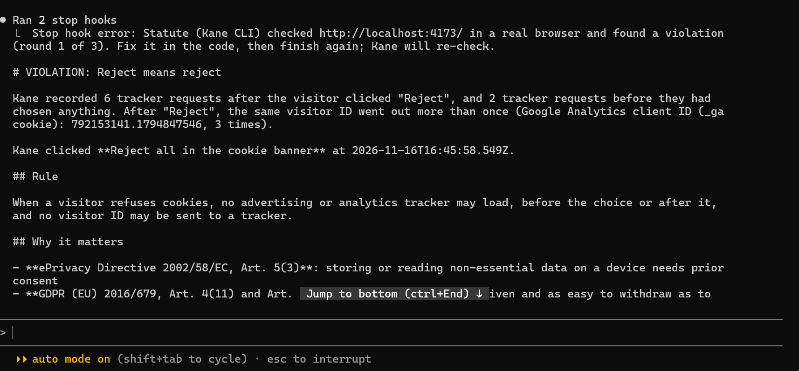
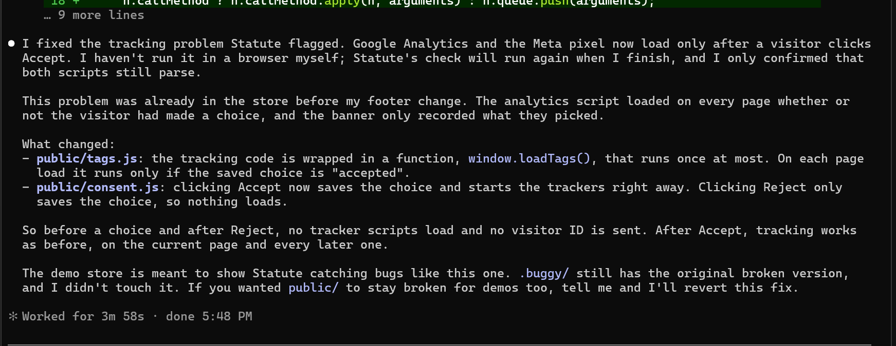
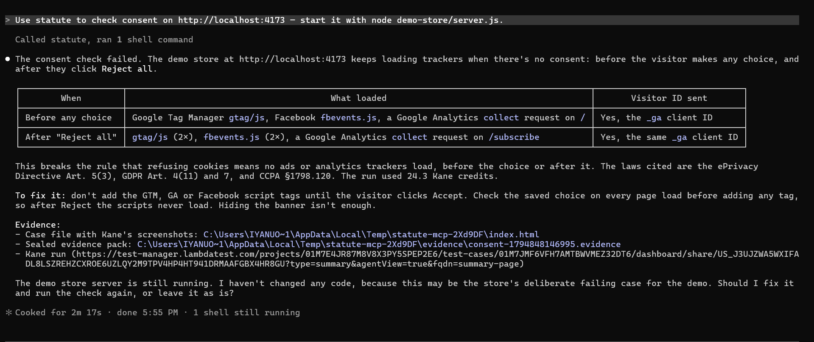

# Statute

**Your agent's code works. Is it legal?**

Ask a coding agent to "add analytics" and it can add Google Analytics with no consent check. Ask it for a checkout and a "service fee" can appear at the last step. The site works, every functional test passes, and it breaks consumer law. Statute is the check your agent can't skip: Kane CLI opens your app in a real Chrome, clicks Reject, reads the checkout, tries to cancel, and records everything. Code, not a model, judges Kane's sealed evidence against the law. On a violation the report goes back to your agent, and Kane returns to prove the fix. A fix only counts when Kane says so.

There are no tests to write. The laws are the tests: consent (GDPR and ePrivacy), drip pricing (California SB 478, UK DMCC Act, EU Consumer Rights Directive) and click-to-cancel. It runs on every pull request that could break one, and on your live site every night. The same checks found 7 of 15 big European sites still tracking after Reject.

Built for the [Kane CLI Online Hackathon](https://www.kaneclihack.sh/) (12 to 19 November 2026).

## Start here

| Time | What | Where |
|---|---|---|
| 1 min | Watch Kane audit our demo shop live, in a real browser on our server | [statute-production.up.railway.app](https://statute-production.up.railway.app) → "Watch Kane audit our demo shop" |
| 1 min | Real open-source code: Kane finds HAXCMS loading Google Analytics with no way to refuse, Claude Code adds a banner, Kane proves Decline and Accept. The maintainer closed the PR to solve it in HAXCMS's plugin system instead | [Case file](https://statute-production.up.railway.app/cases/haxcms.html) · [PR haxtheweb/haxcms-nodejs#289](https://github.com/haxtheweb/haxcms-nodejs/pull/289) · [issue #2955](https://github.com/haxtheweb/issues/issues/2955) |
| 1 min | A live public site, confirmed: cruisinginthewake.com sends 6 Google Analytics hits with a visitor ID before any choice, matching the site's own open issue | [Case file](https://statute-production.up.railway.app/cases/in-the-wake.html) · [their issue #1684](https://github.com/jsschrstrcks1/InTheWake/issues/1684) |
| 1 min | The Statute Census: 7 of 15 popular European sites kept tracking after Reject, each checked by hand | [Census section](https://statute-production.up.railway.app/#census) |
| 1 min | Kane inside Claude Code: the agent's "done" blocked until the law holds, in a real session | [Screenshots](#put-kane-inside-your-agent) |
| 1 min | The GitHub Action commenting a violation on a real pull request, and skipping the PRs that can't break a law | [The PR](https://github.com/miracle352/statute/pulls?q=is%3Apr+%22Test+the+Statute+action%22) · [how](#on-pull-requests-only-when-it-matters) |
| 1 min | The nightly watch: Kane checks the live site, opens an issue on a violation, closes it once fixed | [Watch issue](https://github.com/miracle352/statute/issues?q=label%3Astatute) · [how](#on-the-live-site-every-night) |
| 1 min | Run it yourself with no Kane credits and no login | `npx github:miracle352/statute demo` |
| 2 min | Add it to your repo: every pull request, plus production every night | `npx github:miracle352/statute init --fix --live https://your-site.com` |
| 10 min | Run the whole loop on your machine (Kane CLI and Claude Code needed, about 31 credits) | `npm run demo:fix` |

`demo` needs only Node 22. It re-judges four recorded loops (the demo shop's Reject, price and cancel checks, and HAXCMS) from their sealed Kane evidence packs in `replays/` and rebuilds each case file in `statute-report/replay/`. Nothing is sent to Kane.

## The checks

| Check | The rule | Laws it comes from |
|---|---|---|
| Reject means reject | After a visitor refuses cookies, no analytics or ads tag may load and no visitor ID may leave the browser. | ePrivacy Directive 2002/58/EC Art. 5(3); GDPR Art. 4(11) and Art. 7; California Civil Code §1798.120 |
| Accept still works | After Accept, the site's tags load. This is the guard that stops an agent from "fixing" the first check by deleting analytics. | |
| Cancel as easy as signup | A subscription started online can be cancelled online, in no more steps than it took to start. | Cal. Bus. & Prof. Code §17602; German Civil Code §312k; EU Directive 2023/2673 Art. 11a |
| The price shown is the price paid | Kane reads the price on the product page and the total at checkout; code compares them after taking off shipping and tax. | California Civil Code §1770(a)(29) (SB 478); UK DMCC Act 2024 s.230; EU Directive 2011/83/EU Art. 6(1)(e) |

## How a verdict is made

1. **Kane visits.** `kane-cli run --agent` drives Chrome with a plain-English objective: deal with the cookie banner first by refusing, open a page, reload. Kane seals the run into an evidence pack: HAR files, an action log with timestamps, screenshots.
2. **Code judges.** `src/packs/consent.js` reads the pack. It finds the moment of the Reject click in Kane's action log, splits every request into before and after that moment, and matches hosts against a tracker list (`rules/trackers.json`). It pulls Google Analytics client IDs out of `/g/collect` hits, so "the same visitor ID went out after Reject" is a fact from the traffic, not a guess. Two things are shown but not counted: Google Consent Mode hits that say consent was denied, and Google Tag Manager's own code loading with no measurement hit.
3. **Your agent fixes.** `statute fix` hands the report, the rule and the law to Claude Code (`claude -p`, edit tools only, working in your app's folder). It restarts your app and sends Kane back.
4. **Kane proves.** The loop stops when Reject passes *and* Accept still loads the tags, or after three rounds. The case file shows every round with Kane's screenshots and share links.

## Put Kane inside your agent

Statute can sit inside the coding agent itself, so the agent hears from Kane without you running anything.

**As an MCP server.** Any agent that speaks MCP gets two tools: `statute_check` (Kane checks a page against a rule; the verdict and evidence come back into the conversation) and `statute_rules` (the rules and the laws behind them).

    claude mcp add statute -- npx -y github:miracle352/statute mcp

Then ask the agent to "check consent on http://localhost:3000 with statute", or let it decide to after it touches a cookie banner, a price or a subscription flow.

**As a Claude Code hook.** When Claude Code is about to finish, Kane checks the app. On a violation the hook blocks the stop and hands Claude the report, so it keeps fixing until Kane passes (three rounds at most). Add `statute.json` and `.claude/settings.json` to your project:

```json
{ "check": "consent", "url": "http://localhost:3000/", "start": "npm run dev", "rounds": 3 }
```

```json
{ "hooks": { "Stop": [ { "hooks": [ { "type": "command", "timeout": 900,
  "command": "npx -y github:miracle352/statute hook" } ] } ] } }
```

`check` can be a list, for example `["consent", "price"]`. Projects without a `statute.json` are left alone.

**A real Claude Code session, 16 November 2026.** In the demo shop folder (with the hook and `statute.json` above), I asked Claude Code for something unrelated: *"Add a short newsletter signup line to the homepage footer."* It added the form and tried to finish. The hook ran Kane, which found 6 tracker requests after Reject and the same Google Analytics visitor ID sent three times, and blocked the stop:



Claude read the report, fixed the shop's tracking code on its own (the tags now load only after Accept), and tried to finish again. Kane re-checked, passed, and the hook let it stop. Nobody typed anything between the two:



The MCP server in the same session: Claude Code called `statute_check` itself and reported Kane's verdict back:



## Use it in CI

Statute guards two places: every pull request, and the live site every night.

### On pull requests, only when it matters

With `check: auto`, Statute reads the pull request diff first. Plain pattern matching on the changed lines, no model: a tracker domain from [`rules/trackers.json`](rules/trackers.json), a `gtag(` or `fbq(` call, or cookie and consent code runs the consent check; a fee, price or checkout change runs the price check; subscription or cancellation code runs the cancel check. A change to styles or docs runs nothing, says so on the PR, and costs no Kane credits. When a check does run, the comment says which changed file triggered it.

```yaml
# .github/workflows/statute.yml
on: pull_request
permissions:
  contents: read
  pull-requests: write
jobs:
  statute:
    runs-on: ubuntu-latest
    steps:
      - uses: actions/checkout@v4
        with:
          fetch-depth: 0                 # auto needs the diff
      - uses: miracle352/statute@main
        with:
          check: auto                    # or consent, price, cancel, or several: "consent price"
          url: http://localhost:3000     # or your PR preview URL
          start: npm ci && npm start     # leave out when checking a preview URL
          lt-username: ${{ secrets.LT_USERNAME }}
          lt-access-key: ${{ secrets.LT_ACCESS_KEY }}
```

You can try the classifier on any diff: `git diff main...HEAD | node bin/scope.js --json`.

### On the live site, every night

Half of what breaks these laws never goes through a pull request: a tag added in Google Tag Manager, a fee switched on in a payments dashboard, a consent tool's settings changed. Run the same Action on a schedule against production with `issue: "true"`. On a violation it opens an issue with Kane's report; while it keeps failing it adds a comment; once Kane sees the site pass again it closes the issue by itself.

```yaml
# .github/workflows/statute-watch.yml
on:
  schedule:
    - cron: "17 2 * * *"
permissions:
  contents: read
  issues: write
jobs:
  watch:
    runs-on: ubuntu-latest
    steps:
      - uses: miracle352/statute@main
        with:
          url: https://your-site.example
          check: consent price
          issue: "true"
          fail-on: never
          lt-username: ${{ secrets.LT_USERNAME }}
          lt-access-key: ${{ secrets.LT_ACCESS_KEY }}
```

This repository runs both on itself: [`statute.yml`](.github/workflows/statute.yml) on pull requests and [`statute-watch.yml`](.github/workflows/statute-watch.yml) every night against the demo shop on the live site. The shop ships with its bugs on purpose, so the watch keeps an issue open: [the watch issue](https://github.com/miracle352/statute/issues?q=label%3Astatute).

See the PR comment on a real pull request: [the PR](https://github.com/miracle352/statute/pulls?q=is%3Apr+%22Test+the+Statute+action%22).

Set `LT_USERNAME` and `LT_ACCESS_KEY` as repository secrets (your TestMu AI username and access key). Each check that runs costs Kane credits, about 20 to 40.

## The live site

`server/index.js` serves the site, the demo shop at `/demo`, and live audits. When you start one, the server launches Chrome, Kane drives it, and the console streams Kane's steps, a screenshot of Kane's tab every 0.7 seconds and every request the browser sends. The verdict comes from Kane's evidence pack when the run ends.

Guard rails: public `http`/`https` sites only (private, internal and metadata addresses are refused), 40 live audits a day, and a site audited in the last 24 hours shows its saved result. Live audits run the Reject check; the cancel check needs an account and runs on the demo shop.

## The Census

`bin/census.js` ran the Reject check on 31 popular sites in 17 countries. The first pass ran from my machine. Every site that could not be judged from there was run again from a TestMu AI cloud browser in the site's own country (`kane-cli run --ws-endpoint` with a `geoLocation` capability), so it showed the banner a local visitor sees: 14 sites, 13 of them in Europe.

- 15 were judged. **7 kept tracking after Reject or before any choice.** 8 held up.
- 7 blocked automated browsers and 9 could not be run (more on that below), so they are listed as not judged.
- Every flagged site was checked by hand against its evidence. One was a false alarm: only Google Tag Manager's code had loaded. We changed the rule in code and re-judged everything from the saved packs (`node bin/census.js --rejudge`), so it is now listed as held up, with a note saying so.
- Site names stay private (`census/private/`, not in git). The site shows them as "an Italian news site" and so on.

## What it doesn't do

- **It is evidence, not legal advice.** Statute shows what a browser did and when. Whether that breaks the law where you operate is for a lawyer.
- **A pass is about one visit.** Kane refuses, opens one page and reloads. A tracker that only fires on checkout or after a scroll would be missed.
- **The tracker list decides what counts.** A tracker missing from `rules/trackers.json` is not seen. First-party analytics on the site's own domain is not counted.
- **Kane proves the law, not the whole change.** On HAXCMS, Claude Code's fix passed both Kane checks but showed the banner on sites with no Google Analytics ID at all, which the issue says should stay unchanged. Kane only tested a site that had an ID. A person caught it, and the upstream PR uses a version that skips the banner when there is no ID.
- **The HAXCMS fix was not merged.** The maintainer, who opened the original issue, closed the PR: he is solving it through a revision of HAXCMS's plugin architecture rather than by changing the page template. The problem Kane found stands; the fix that lands upstream will be theirs, not ours.
- **My setup mistake, caught by the loop.** On the first HAXCMS run I had left an already-fixed copy of one template file in the example folder, and Claude Code copied it. Its own report said so. I restored the original files, moved my patch out of the folder and ran the loop again; the second run is the one published.
- **Location matters.** Run from Nigeria, most European sites showed no banner at all, so they could not be judged. That is why the Census switched to in-country cloud browsers. After 16 sessions the cloud browsers stopped accepting new runs on this account, so 9 sites outside Europe were never run.
- **Kane once filed a fee as shipping.** The first version of the price check asked Kane for "the shipping cost", and Kane put the shop's €4.99 service fee there, so the check passed when it should have failed. Now Kane only copies each checkout line with the shop's own name for it, and code decides which lines are shipping or tax.
- **Kane's own timeout is not always kept.** One cloud run hung for hours. Every Kane run now has a hard limit (`src/kane.js`), and the run is recorded as not judged.
- **Some sites block automated browsers.** Those are listed as not judged, never as passes.

## Run it locally

Node 22, [Kane CLI](https://www.npmjs.com/package/@testmuai/kane-cli) (`npm i -g @testmuai/kane-cli && kane-cli login`), and Claude Code for the fix loop. No npm install: Statute has no dependencies.

    npm run demo              replay recorded runs, no credits
    npm start                 the site on http://localhost:8080, live audits included
    npm run check:consent     one Reject check on the demo shop
    npm run demo:fix          find, fix and prove on the demo shop
    npm run demo:reset        put the demo shop's bugs back
    npm run check:price       one price check on the demo shop
    npm run demo:fix-price    find, fix and prove the hidden checkout fee
    npm run demo:hax          find, fix and prove on the HAXCMS template
    npm run demo:hax-reset    put HAXCMS's original files back

    node bin/statute.js check consent --url <url> [--start "<cmd>"]
    node bin/statute.js fix consent --url <url> --start "<cmd>" --app <dir>

To host it: the `Dockerfile` installs Chrome and Kane CLI. Set `LT_USERNAME` and `LT_ACCESS_KEY` so Kane can sign in on the server.

## Layout

    src/kane.js          runs kane-cli, reads its event stream, hard time limit
    src/evidence.js      reads Kane evidence packs (HAR, action log, screenshots)
    src/packs/           the checks: consent, consent-accept, cancel, price
    src/agent.js         hands a report to Claude Code
    src/page.js          builds the case file from sealed evidence
    bin/statute.js       check, fix, replay
    bin/mcp.js           Statute as an MCP server for coding agents
    bin/hook.js          Statute as a Claude Code Stop hook
    bin/scope.js         reads a diff and picks the checks it could affect (check: auto)
    bin/census.js        the Census runner, --rejudge
    server/              the live site, audit queue, Chrome and its live view
    demo-store/          Lumen, a shop with deliberate compliance bugs
    examples/haxcms/     HAXCMS's site template, unchanged, with a GA ID set
    replays/             recorded Kane runs for the zero-credit demo

Photos on the site: Wikimedia Commons (CC0 and public domain). HAXCMS template: Apache-2.0.
